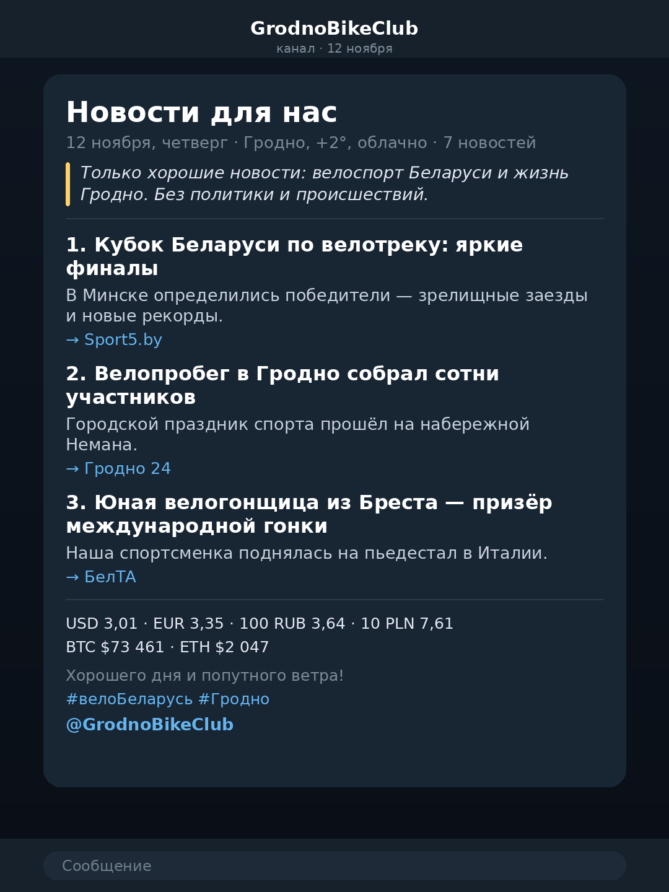

# 🚴 Велодайджест Беларуси → Telegram

[](https://github.com/f1devbin/GrodnoBikeClub/actions/workflows/daily.yml)
[](https://www.python.org/)
[](https://python-pillow.org/)
[](LICENSE)

Бот каждый день в **12:00 по Минску** собирает велосипедные новости Беларуси,
даёт ИИ-модели отобрать лучшее и переписать в позитивном тоне, а если велоновостей
мало — добавляет добрые новости Гродно. Готовый пост публикуется в ваш
Telegram-канал или группу.

**Главное:** бот работает на серверах GitHub (GitHub Actions), а не на вашем
компьютере. Компьютер можно выключать — публикация всё равно произойдёт.



---

## Возможности

- 🤖 **ИИ-редактор** — отбирает новости и переписывает тексты в позитивном тоне
  (Gemini, любая OpenAI-совместимая модель).
- 🚫 **Без негатива** — двойной фильтр: стоп-слова + инструкция модели.
- 🌤 **Погода в тексте** — Гродно, температура и описание в подзаголовке.
- 🔗 **Ссылка на канал** — `@GrodnoBikeClub` внизу каждого поста.
- 💱 **Курсы** — НБРБ (USD, EUR, RUB, PLN) и CoinGecko (BTC, ETH).
- 🧠 **Память** — уже опубликованные новости не повторяются (`state.json`).
- 🎨 **Rich-посты** Bot API 10.x: заголовки, цитата, список, разделители.
- 🕛 **Расписание** — ежедневно в 12:00 по Минску, ПК может быть выключен.

---

## Как это устроено

```
RSS (Google News + GrodnoNews)   Open-Meteo (погода)   НБРБ + CoinGecko (курсы)
        │                             │                       │
        ▼                             └──────────┬────────────┘
Фильтр негатива (политика, ДТП, криминал)         │
        │                                         ▼
        ▼                                 Погода в подзаголовке,
ИИ-модель: отбирает новости и переписывает   курсы внизу поста
их позитивно, коротко и по делу
        │
        ▼
Rich message: заголовок, цитата, список, ссылка на канал
        │
        ▼
Telegram: ежедневно в 12:00 по Минску
```

Если ИИ недоступен (нет ключа, лимит, ошибка) — бот не падает, а публикует
аккуратный дайджест, собранный без ИИ. Повторно уже отправленные новости не
публикуются: память хранится в файле `state.json` прямо в репозитории.

---

## Оформление поста

Пост отправляется методом **`sendRichMessage`** (Bot API 10.x, «rich messages»):
заголовок, дата, цитата-подзаголовок, разделители и подзаголовок для каждой
новости. В ленте это выглядит как аккуратная мини-статья, а не как список строк:

```html
<h2>🚴 Новости для нас</h2>
<p>12 ноября, четверг · Гродно, +2°, облачно · 7 новостей</p>
<blockquote>Только хорошие новости: велоспорт и Гродно. Без политики и происшествий.</blockquote>
<hr/>
<h4>🏁 1. Кубок Беларуси по велотреку: яркие финалы</h4>
<p>В Минске определились победители — зрелищные заезды и новые рекорды.</p>
<p><a href="https://…">→ Sport5.by</a></p>
```

Если сервер/клиент не поддерживает rich-сообщения или API вернёт ошибку,
бот **автоматически** отправит обычный HTML-пост — публикация не сорвётся.
Принудительно включить обычный формат: `--classic` или `"use_rich": false`
в `config.json`.

---

## Погода, курсы и ссылка на канал

- **Погода** берётся из Open-Meteo (бесплатно, без ключа) и выводится в
  подзаголовке: например, «12 ноября, четверг · Гродно, +2°, облачно».
- **Курсы** НБРБ (USD, EUR, RUB, PLN) и CoinGecko (BTC, ETH) выводятся внизу
  поста одной аккуратной строкой.
- **Ссылка на канал** — последняя строка поста: `@GrodnoBikeClub`
  (настраивается в `config.json` → `channel`).
- **Обложка отключена** (`cover.enabled: false`). Генератор остался в проекте:
  включите флаг — и бот снова будет присылать картинку с датой и погодой.
- Если какой-то источник недоступен — соответствующий блок просто не
  появляется, выпуск всё равно выходит.

Пример, как это выглядит в Telegram: `mockup.png` (приблизительный макет).

---

## Память: как бот не повторяется

ИИ-модель ничего не помнит — она каждый день получает только новые новости.
«Память» — это файл `state.json` в репозитории:

1. Перед сборкой бот считает отпечаток каждой новости (SHA-1 от нормализованного
   заголовка) и выбрасывает те, что уже есть в `state.json`.
2. Только новые новости попадают в промпт ИИ.
3. После успешной публикации отпечатки дописываются в `state.json`.
4. Workflow коммитит обновлённый `state.json` обратно в репозиторий
   (`chore: update digest state [skip ci]`), поэтому память не зависит от кэшей
   GitHub и переживает всё, кроме удаления файла.
5. Записи старше 45 дней автоматически вычищаются.

Что важно знать:

- **Не удаляйте `state.json`** — иначе бот может повторить новости за последние
  60 дней (окно поиска).
- В workflow уже включено `permissions: contents: write` — без этого коммит
  состояния не пройдёт.
- Если в репозитории включена защита ветки, коммит может быть отклонён: бот
  продолжит публиковать, но память не обновится. Разрешите push для
  `github-actions[bot]` или используйте ветку без защиты.
- Один маленький коммит в день — плата за надёжность.

---

## Быстрый старт (15 минут, один раз)

### Шаг 1. Создайте бота

1. Откройте в Telegram **@BotFather** → `/newbot`.
2. Придумайте имя и username (должен заканчиваться на `bot`).
3. Скопируйте токен вида `123456789:AAH...` — это `TELEGRAM_BOT_TOKEN`.

### Шаг 2. Добавьте бота в группу и узнайте chat_id

1. Добавьте бота в вашу группу.
2. Сделайте бота **администратором** группы (или разрешите отправку сообщений).
3. Напишите в группе любое сообщение (например, «тест»).
4. Откройте в браузере:

   `https://api.telegram.org/bot<ВАШ_ТОКЕН>/getUpdates`

5. Найдите `"chat":{"id":-1001234567890,...}` — число с минусом и есть
   `TELEGRAM_CHAT_ID` (у групп и супергрупп он отрицательный).

> Если чат не появляется — напишите в группу ещё раз и обновите страницу.
> Для супергруппы с темами можно дополнительно указать `TELEGRAM_THREAD_ID`
> (id темы), но это необязательно.

### Шаг 3. Получите ключ ИИ (рекомендуется)

По умолчанию используется **Google Gemini** (есть бесплатный тариф):

1. Откройте <https://aistudio.google.com/apikey>.
2. Создайте API-ключ и скопируйте его — это `AI_API_KEY`.

Можно использовать любую OpenAI-совместимую модель — достаточно поменять
`base_url` и `model` в `config.json`:

| Провайдер | base_url | Пример модели |
|---|---|---|
| Google Gemini | `https://generativelanguage.googleapis.com/v1beta/openai` | `gemini-2.5-flash` |
| OpenRouter | `https://openrouter.ai/api/v1` | `deepseek/deepseek-chat-v3-0324:free` |
| Groq | `https://api.groq.com/openai/v1` | `llama-3.3-70b-versatile` |
| DeepSeek | `https://api.deepseek.com` | `deepseek-chat` |

### Смена провайдера ИИ

Код работает с любым OpenAI-совместимым API. Чтобы перейти на Groq, добавьте
три секрета (и удалите старый `AI_API_KEY` или замените его):

| Секрет | Значение |
|---|---|
| `AI_API_KEY` | ключ Groq (`gsk_...`) |
| `AI_BASE_URL` | `https://api.groq.com/openai/v1` |
| `AI_MODEL` | `llama-3.3-70b-versatile` |

Другие варианты: OpenRouter (`https://openrouter.ai/api/v1`), DeepSeek
(`https://api.deepseek.com`). Менять код при этом не нужно.

### Шаг 4. Загрузите проект на GitHub

1. Создайте новый репозиторий (можно **приватный**).
2. Загрузите в него **содержимое** папки `velo-news-bot`
   (файлы `main.py`, `config.json`, папку `.github` и остальное).
3. Убедитесь, что workflow лежит по пути
   `.github/workflows/daily.yml` в ветке `main`.

> Если веб-загрузка не принимает папку `.github` — создайте файл вручную:
> **Add file → Create new file**, имя `.github/workflows/daily.yml`,
> и вставьте содержимое файла.

### Шаг 5. Добавьте секреты

В репозитории: **Settings → Secrets and variables → Actions → New repository secret**

| Имя секрета | Значение |
|---|---|
| `TELEGRAM_BOT_TOKEN` | токен из шага 1 |
| `TELEGRAM_CHAT_ID` | id группы из шага 2 |
| `AI_API_KEY` | ключ ИИ из шага 3 (можно пропустить — будет простой режим) |
| `AI_BASE_URL` | необязательно: сменить провайдера ИИ (например, Groq) |
| `AI_MODEL` | необязательно: имя модели у провайдера |
| `TELEGRAM_THREAD_ID` | необязательно, id темы в супергруппе |

### Шаг 6. Проверьте

1. Вкладка **Actions** → workflow **Velo Digest** → **Run workflow**.
2. Через 1–2 минуты проверьте группу — должен прийти пост.
3. Если что-то не так — откройте лог запуска, там понятные сообщения
   (`[collect]`, `[ai]`, `[telegram]`, `[state]`).

Локальная проверка без отправки:

```bash
python3 main.py --dry-run      # показать пост в консоли
python3 main.py --no-ai        # проверить режим без ИИ
python3 main.py --classic      # принудительно обычный формат поста
```

---

## Расписание

```yaml
- cron: "0 9 * * *"   # 09:00 UTC = 12:00 Минск
```

- GitHub может запустить задачу с задержкой 5–20 минут — это нормально.
- Время менять здесь: `0 9 * * *` → нужный час **в UTC**
  (Минск = UTC+3: 12:00 Минск = 09:00 UTC).
- ⚠️ GitHub отключает расписания после **60 дней без коммитов** в репозитории.
  Раз в пару месяцев сделайте любой коммит (или нажмите Run workflow).

---

## Настройка `config.json`

| Параметр | Что делает |
|---|---|
| `digest.max_items` | сколько новостей в посте (по умолчанию 7) |
| `digest.min_cycling` | если велоновостей меньше — добавляем Гродно |
| `digest.lookback_hours_cycling` | окно поиска велоновостей (1440 ч = 60 дней) |
| `digest.lookback_hours_grodno` | окно для новостей Гродно |
| `queries.cycling` / `queries.grodno` | поисковые запросы |
| `direct_feeds` | прямые RSS-ленты (например, GrodnoNews) |
| `negative_keywords` | стоп-слова: политика, происшествия, криминал |
| `grodno_topics` | позитивные темы для Гродно |
| `ai.enabled` | включить/выключить ИИ |
| `ai.model`, `ai.base_url` | какая модель готовит текст |
| `telegram.use_rich` | отправлять красивые rich-посты (по умолчанию `true`) |
| `cover.enabled` | обложка-картинка (по умолчанию выключена) |
| `channel.url`, `channel.name` | ссылка на канал внизу поста |
| `weather.enabled` | показывать погоду Гродно |
| `rates.enabled` | показывать курсы валют и криптовалют |

Все параметры можно менять прямо на GitHub (карандаш → Commit changes).

> Почему окно 60 дней (на время теста): велоновостей по Беларуси в межсезонье мало. Бот берёт
> более старые материалы, но никогда не повторяет уже отправленные — поэтому
> постепенно «расходует» накопленный запас, а свежие новости идут первыми.

---

## Что фильтруется

- **Политика**: выборы, санкции, заявления, протесты и т. п.
- **Происшествия**: ДТП, пожары, кражи, суды, криминал, трагедии.
- **Негатив**: скандалы, конфликты, жалобы, подорожания.

ИИ дополнительно проверяет тексты и не включает негатив. Если ИИ отключён,
работает фильтр по ключевым словам.

---

## Частые проблемы

| Симптом | Решение |
|---|---|
| `chat not found` | бот не добавлен в группу или неверный `TELEGRAM_CHAT_ID` |
| `not enough rights` | сделайте бота администратором группы |
| `401/403` от ИИ | проверьте `AI_API_KEY`, `base_url` и `model` |
| `404` от ИИ | бот сам подберёт доступную модель; можно задать свою через секрет `AI_MODEL` |
| `429` от ИИ | лимит провайдера — бот сам перейдёт в простой режим |
| Пост не пришёл | Actions → запуск → лог; проверьте, что workflow в ветке `main` |
| Пришёл пустой пост | не нашлось новостей — бот пришлёт позитивную заглушку |
| rich-пост не отправился | бот сам пришлёт обычный пост, в логе будет `фолбэк` |
| `state.json` не коммитится | защита ветки: разрешите push для `github-actions[bot]` |

---

## Безопасность

- Токен бота и ключ ИИ хранятся только в **Secrets** GitHub и не попадают в код.
- Никогда не коммитьте `.env` и не вставляйте ключи в `config.json`.
- Если токен утёк — `/revoke` у @BotFather и обновите секрет.

## Файлы

```
main.py                        — сбор, фильтрация, ИИ, отправка
state.json                     — память об уже отправленных новостях
extras.py                      — погода, курсы, генерация обложки
config.json                    — запросы, фильтры, модель, лимиты
requirements.txt               — зависимость: pillow
.github/workflows/daily.yml    — расписание и запуск на GitHub
scripts/mockup.py              — генерация макета поста
mockup.png                     — пример, как выглядит пост
LICENSE                        — MIT
```

## Лицензия

MIT — см. [LICENSE](LICENSE).
